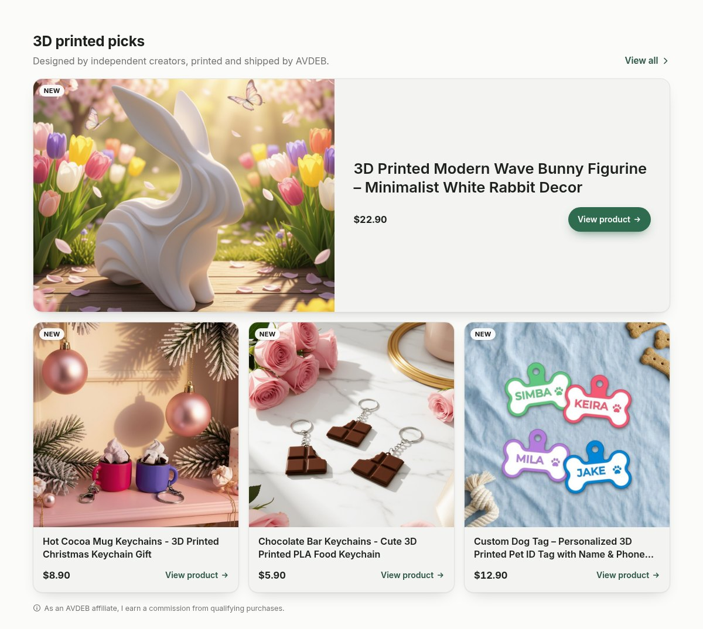

# astro-avdeb

Show [AVDEB](https://avdeb.com/developers/#astro) products on your Astro site (a creator's shop, a category, a search or a single product) with **your referral code on every link**.



- **Three components:** `<AvdebProducts>`, `<AvdebProduct>` and `<AvdebButton>`. They work in `.astro` pages, layouts and MDX.
- **Four layouts:** grid, carousel (scroll-snap with keyboard and arrow buttons), list ("shop the post") and spotlight (first product featured). Single products render as a horizontal card, a hero or a compact card, with your own badge and note.
- **Fits any theme:** container queries let embeds adapt to the column they sit in. Choose inherit, light, dark or system theme, one of three card styles, plus accent colour, corner radius and image shape.
- **Easy to restyle:** every rule is `:where()`-wrapped, so your CSS always wins. 25+ `--avdeb-*` design tokens, `class` and `style` on every component, `styles: false` to bring your own CSS, and a headless `getAvdebProducts()` for fully custom markup.
- **Fast and resilient:** products are fetched at build or render time on the server and cached in memory per query. Identical embeds share one request. If AVDEB can't be reached, the last good copy is served for a week.
- **Honest links:** referral links get `rel="sponsored"`, and an optional disclosure line appears under embeds that carry a code.
- **Private by default:** no third-party scripts, cookies, iframes or tracking. The only client JS is ~40 lines for carousel arrows. Your secret key never reaches the browser.

Works with Astro 5, 6 and 7, with static output (SSG) and with server output on any adapter.

## Install

```sh
npx astro add astro-avdeb
```

Or manually:

```sh
npm install astro-avdeb
```

```js
// astro.config.mjs
import { defineConfig } from "astro/config";
import avdeb from "astro-avdeb";

export default defineConfig({
	integrations: [avdeb()],
});
```

Then add your key or referral code to `.env` (see [Become an AVDEB affiliate](#become-an-avdeb-affiliate-or-creator)):

```sh
# Either: secret key from Partner dashboard → Embeds & API (adds your code automatically, up to 48 products per embed)
AVDEB_SECRET_KEY=avdeb_sk_...
# Or: just your referral code (up to 12 products per embed)
AVDEB_REF_CODE=YOURCODE
```

Without either one, embeds still work, but the links don't earn commission.

## Use

```astro
---
import { AvdebProducts, AvdebProduct, AvdebButton } from "astro-avdeb/components";
---

<!-- Paste any AVDEB creator, category or product link; the source is detected automatically -->
<AvdebProducts url="https://avdeb.com/creators/cleo/" heading="From my shop" />

<AvdebProducts tag="stickers" layout="carousel" columns={4} limit={10} />
<AvdebProducts q="keychain" layout="list" limit={3} />
<AvdebProducts tag="3d-prints" layout="spotlight" theme="dark" accentColor="#e0a84f" />

<AvdebProduct handle="cat-sticker" variant="hero" badge="Editor's pick" note="I use it every day." />

<AvdebButton href="/creators/cleo/" label="Visit my shop" variant="outline" align="center" />
```

In MDX, import the components at the top of the file and use them the same way.

### `<AvdebProducts>`

| Prop | Type | Default | |
|---|---|---|---|
| `url` | string | | Any `avdeb.com/creators/…`, `/category/…` or `/store/…` link |
| `creator` / `tag` / `type` / `q` | string | | Creator slug, category slug, product type, search phrase. Leave all empty for the newest products |
| `limit` | number | 6 | Up to 12 without a secret key, 48 with one |
| `layout` | `grid` \| `carousel` \| `list` \| `spotlight` | `grid` | |
| `columns` | 1–6 | 3 | Fewer on narrow containers automatically |
| `heading`, `intro` | string | | Optional header above the products |
| `headingLevel` | 2–5 | 2 | Card titles use the next level |
| `viewAll`, `viewAllLabel` | boolean, string | `true`, "View all" | "View all" link for creator and category embeds |
| `cardStyle` | `elevated` \| `outline` \| `minimal` | `elevated` | |
| `theme` | `inherit` \| `light` \| `dark` \| `auto` | `inherit` | `inherit` uses your text colour on a transparent background |
| `accentColor` | hex | AVDEB green | Prices, badges, buttons |
| `radius` | 0–32 | 16 | Corner radius in px |
| `imageRatio` | `square` \| `portrait` \| `landscape` | `square` | |
| `ctaLabel` | string | "View product" | |
| `hidePrice`, `hideCreator`, `hideBadges` | boolean | | |
| `newTab` | boolean | `false` | |
| `class`, `style` | string | | Added to the root `<section>` |

### `<AvdebProduct>`

`handle` (a product handle or an `avdeb.com/store/…` link), `variant` (`horizontal` by default, `hero` or `card`), `badge`, `note`, and the same styling props as `<AvdebProducts>`.

### `<AvdebButton>`

`href` (an avdeb.com URL or a path such as `/store/cat-sticker/`; other hosts render as plain text), `label`, `variant` (`solid`, `outline` or `link`), `align` (`start`, `center` or `end`), `accentColor`, `newTab`, `class`, `style`.

## Options

Every display option sets the site-wide default; component props override it per embed.

```js
avdeb({
	apiKey: undefined,        // default: AVDEB_SECRET_KEY
	refCode: undefined,       // default: AVDEB_REF_CODE
	layout: "grid",
	columns: 3,
	cardStyle: "elevated",
	theme: "inherit",
	accentColor: "",          // hex, e.g. "#7c3aed"
	radius: 16,
	imageRatio: "square",
	ctaLabel: "View product",
	showPrice: true,
	showCreator: true,
	showBadges: true,         // "−25%" sale and "New" badges
	newTab: false,
	showDisclosure: true,     // shown only when links carry a referral code
	disclosureText: "As an AVDEB affiliate, I earn a commission from qualifying purchases.",
	locale: undefined,        // price format; default: Astro.currentLocale, else "en-US"
	cacheMinutes: 360,        // in-memory product cache (SSR); a build fetches each query once
	requestsPerMinute: 120,
	styles: true,             // false = ship no CSS
});
```

## Styling

The defaults are designed to look native on most themes. When you want your own look, you have five levels of control:

**1. Props and options:** `theme`, `cardStyle`, `accentColor`, `radius`, `imageRatio`.

**2. Design tokens:** set `--avdeb-*` custom properties on `.avdeb` to restyle every embed, or on a class you pass to one embed. Values in your CSS win over options and props.

```css
.avdeb {
	--avdeb-accent: #ff4d00;
	--avdeb-radius: 0px;
	--avdeb-gap: 1.5rem;
	--avdeb-font-title: "Fraunces", serif;
}
```

| Token | |
|---|---|
| `--avdeb-accent`, `--avdeb-accent-contrast`, `--avdeb-accent-text` | Accent, text on accent, accent used as text |
| `--avdeb-surface` | Section background (light/dark/auto themes) |
| `--avdeb-card-bg`, `--avdeb-card-pad`, `--avdeb-border`, `--avdeb-border-soft` | Cards |
| `--avdeb-media-bg` | Image placeholder background |
| `--avdeb-muted` | Secondary text |
| `--avdeb-badge-bg`, `--avdeb-badge-text` | Badges |
| `--avdeb-shadow`, `--avdeb-shadow-hover` | Elevated cards |
| `--avdeb-radius`, `--avdeb-ratio`, `--avdeb-cols`, `--avdeb-gap`, `--avdeb-pad` | Shape and layout |
| `--avdeb-font-title`, `--avdeb-heading-size`, `--avdeb-title-size`, `--avdeb-title-leading`, `--avdeb-price-size` | Type |
| `--avdeb-ease` | Motion curve |
| `--avdeb-btn-bg`, `--avdeb-btn-color` | `<AvdebButton>` |

**3. Your own selectors:** all default rules have zero specificity, so plain class selectors override them:

```css
.brutal .avdeb-card { border-width: 2px; box-shadow: 6px 6px 0 #111; }
```

```astro
<AvdebProducts tag="stickers" class="brutal" cardStyle="outline" />
```

The markup uses stable BEM classes: `.avdeb`, `.avdeb--{layout}`, `.avdeb--{cardStyle}`, `.avdeb__header`, `.avdeb__heading`, `.avdeb__intro`, `.avdeb__items`, `.avdeb-card`, `.avdeb-card--featured`, `.avdeb-card__media`, `.avdeb-card__title`, `.avdeb-card__by`, `.avdeb-card__price`, `.avdeb-card__cta`, `.avdeb-badge`, `.avdeb__disclosure`, `.avdeb-btn`, `.avdeb-btn--{variant}`. The root has `data-theme` and the Tailwind `not-prose` class.

**4. Bring your own CSS:** `avdeb({ styles: false })` ships no stylesheet. To start from the defaults, import them yourself, for example into a cascade layer:

```css
@import "astro-avdeb/styles.css" layer(avdeb);
```

**5. Headless:** render products with your own markup:

```astro
---
import { getAvdebProducts } from "astro-avdeb/data";
const { cards, viewAll, disclosure } = await getAvdebProducts({ tag: "stickers", limit: 4 });
---
<ul>
	{cards.map((c) => (
		<li><a href={c.href} rel={c.rel} target={c.target}> {c.title} — {c.price}</a></li>
	))}
</ul>
{disclosure && <small>{disclosure}</small>}
```

Each card has `href` (with your referral code), `rel`, `target`, `title`, `image`, `width`, `height`, `price`, `compareAt`, `discount`, `isNew` and `creator`. Raw API products are in `products`.

## Become an AVDEB affiliate (or creator)

You only need an account to earn commission. Program details:
[avdeb.com/affiliate](https://avdeb.com/affiliate/): 5% commission, 30-day cookie, monthly PayPal payouts in USD
($50 minimum), open worldwide, approval usually within 24 hours.

1. Open [avdeb.com/affiliate/apply](https://avdeb.com/affiliate/apply/).
2. **Account:** email + password (or *Sign in* if you already have an AVDEB account).
3. **Program:** *Affiliate* (share products, earn commission), *Creator* (submit sticker or 3D designs that
   AVDEB prints and ships; you earn on every sale), or both.
4. **Personal information & details:** first and last name, country, tax residency, legal name (business name optional).
5. **Address:** street, city, state/province, postal code.
6. **Payout & promotion:** PayPal email for commissions; optionally your website and social links.
7. Accept the Terms & Conditions and Privacy Policy, then click **Create Account & Apply**.
8. After approval you get your referral link by email and in the dashboard.
9. In the partner dashboard, open **Embeds & API** ([direct link](https://avdeb.com/affiliate/dashboard/developers/)) and
   create a **secret key** (`avdeb_sk_…`), or copy your referral code from **Links**.
10. Put it in `.env` as `AVDEB_SECRET_KEY` (or `AVDEB_REF_CODE`) and rebuild. Every product link now carries your code.

Creators: once your designs are listed, show them with `<AvdebProducts creator="your-slug" />`.

Please disclose affiliate links to your readers. The disclosure line is on by default.

## How it works

- Components fetch `https://api.avdeb.com/v1/catalog/products` on the server, at build time for static pages and at request time for on-demand pages. Pages are plain HTML links and images.
- With a secret key, requests send `Authorization: Bearer avdeb_sk_…` and the API returns links that already carry your code. Without one, `?ref=` is added to every link.
- Each query is cached in memory, so every page of a build shares one request per query. If a request fails, the last good result (up to a week old) is served, retried after 15 minutes, and logged. At most `requestsPerMinute` calls are made.
- The secret key is read on the server only. It is never rendered into HTML or sent to client scripts.
- All product data is validated before rendering: only `https://avdeb.com` links and `https://` images get through.

## Development

Requires Node 22.12+.

```sh
npm install
npm test           # unit tests (node --test)
npm run typecheck

# demo site with every layout
npm pack --pack-destination demo
cd demo && npm install astro ./astro-avdeb-*.tgz && npx astro dev
```

## License

MIT © AVDEB
